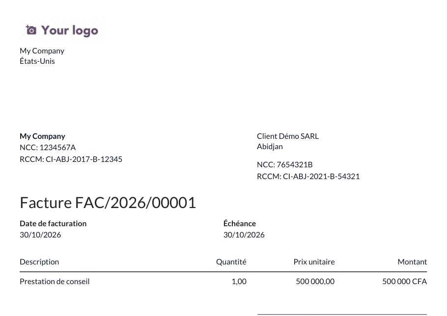

# Odoo Partner NCC / RCCM (Côte d'Ivoire)

🇫🇷 [Français](#français) · 🇬🇧 [English](#english)

## Français

Le module `res_partner_ncc` ajoute le NCC (numéro de compte contribuable) et le RCCM (registre du commerce et du crédit mobilier) sur les contacts de type société, avec normalisation, contrôle de format et unicité du NCC par société.
Le NCC et le RCCM du client et de votre société s'impriment sur la facture PDF, uniquement s'ils sont renseignés.

### Fonctionnement

- Champs visibles uniquement sur les sociétés, et cherchables dans la recherche des contacts.
- Saisie normalisée : majuscules, espaces supprimés (` 1234567 a ` devient `1234567A`).
- Un NCC ne peut être utilisé qu'une fois par société Odoo (les contacts partagés entre sociétés comptent comme un même groupe).
- Facture : les identifiants du client sont lus sur la société du contact facturé ; ceux de votre société se saisissent sur sa fiche dans *Contacts*.

### Formats retenus (à confirmer)

Les formats officiels exacts n'ont pas été vérifiés auprès de la DGI ni du greffe. Le contrôle est volontairement souple :

| Champ | Expression régulière | Exemple accepté |
|---|---|---|
| NCC | `^\d{7,9}[A-Z]?$` : 7 à 9 chiffres, éventuellement suivis d'une lettre | `1234567A` |
| RCCM | `^CI[A-Z0-9-]{6,30}$` : commence par `CI`, puis lettres, chiffres et tirets | `CI-ABJ-2017-B-12345` |

Pour adapter un format, modifiez `NCC_PATTERN` ou `RCCM_PATTERN` dans [`models/res_partner.py`](res_partner_ncc/models/res_partner.py).

### Prérequis

- Odoo 18 (Community ou Enterprise), module `account`

### Installation

1. Copiez le dossier `res_partner_ncc` dans votre chemin d'addons.
2. Redémarrez Odoo et mettez à jour la liste des applications.
3. Installez **Partner NCC / RCCM (Côte d'Ivoire)**.

### Version supportée

Odoo **18.0** uniquement. Tests automatisés (GitHub Actions) sur Odoo 18 Community (image `odoo:18`) + PostgreSQL 16, à chaque push.

### Licence

[LGPL-3](LICENSE)

### Auteur

Koffi Modeste Junior — [@Junmodeste](https://github.com/Junmodeste)

## English

The `res_partner_ncc` module adds the Ivorian NCC (taxpayer account number) and RCCM (trade register) on company contacts, with input normalization, format check and NCC uniqueness per company.
The customer's and your company's NCC and RCCM are printed on the PDF invoice, only when they are set.

### Behavior

- Fields shown on companies only, and searchable in the contacts search view.
- Input normalized: upper case, spaces removed (` 1234567 a ` becomes `1234567A`).
- An NCC can be used only once per Odoo company (contacts shared between companies count as one group).
- Invoice: customer identifiers are read on the commercial partner; your company's identifiers are set on its contact record.

### Formats (to be confirmed)

The exact official formats have not been checked with the tax office (DGI) or the court registry. The check is intentionally loose:

| Field | Regular expression | Accepted example |
|---|---|---|
| NCC | `^\d{7,9}[A-Z]?$`: 7 to 9 digits, optionally followed by a letter | `1234567A` |
| RCCM | `^CI[A-Z0-9-]{6,30}$`: starts with `CI`, then letters, digits and dashes | `CI-ABJ-2017-B-12345` |

To change a format, edit `NCC_PATTERN` or `RCCM_PATTERN` in [`models/res_partner.py`](res_partner_ncc/models/res_partner.py).

### Requirements

- Odoo 18 (Community or Enterprise), `account` module

### Installation

1. Copy the `res_partner_ncc` folder into your addons path.
2. Restart Odoo and update the apps list.
3. Install **Partner NCC / RCCM (Côte d'Ivoire)**.

### Supported version

Odoo **18.0** only. Automated tests (GitHub Actions) run on Odoo 18 Community (`odoo:18` image) + PostgreSQL 16 on every push.

### License

[LGPL-3](LICENSE)

### Author

Koffi Modeste Junior — [@Junmodeste](https://github.com/Junmodeste)
