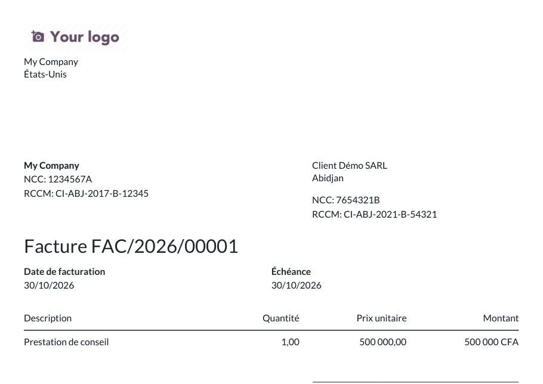

# Odoo Partner NCC / RCCM (Côte d'Ivoire)

🇫🇷 [Français](#français) · 🇬🇧 [English](#english)

## Français

Le module `res_partner_ncc` ajoute le NCC (numéro de compte contribuable) et le RCCM (registre du commerce et du crédit mobilier) sur les contacts de type société, avec normalisation, contrôle de format et unicité du NCC par société.
Le NCC et le RCCM du client et de votre société s'impriment sur la facture PDF, uniquement s'ils sont renseignés.

### Fonctionnement

- Odoo 20 : NCC et RCCM sont des identifiants natifs (`additional_identifiers`, clés `CI_NCC` et `CI_RCCM`). Ils se saisissent dans le widget d'identifiants de la fiche société (pays : Côte d'Ivoire) ou dans *Paramètres > Sociétés*, et se cherchent dans la recherche des contacts. Les champs Python `ncc` et `rccm` restent disponibles (lecture, écriture, recherche).
- Saisie normalisée : majuscules, espaces supprimés (` 1234567 a ` devient `1234567A`) et format contrôlé par la validation native d'Odoo.
- Un NCC ne peut être utilisé qu'une fois par société Odoo (les contacts partagés entre sociétés comptent comme un même groupe) ; les contacts d'une même société partagent ses identifiants.
- Facture : les identifiants du client sont lus sur la société du contact facturé ; ceux de votre société se saisissent dans *Paramètres > Sociétés* (ou sur sa fiche dans *Contacts*, c'est le même enregistrement).
- Mise à jour depuis `20.0.1.x` : migration automatique des colonnes `ncc` / `rccm` vers `additional_identifiers`. Un doublon de NCC n'est plus une erreur SQL mais une `ValidationError`.

### Formats retenus (à confirmer)

Les formats officiels exacts n'ont pas été vérifiés auprès de la DGI ni du greffe. Le contrôle est volontairement souple :

| Champ | Expression régulière | Exemple accepté |
|---|---|---|
| NCC | `^\d{7,9}[A-Z]?$` : 7 à 9 chiffres, éventuellement suivis d'une lettre | `1234567A` |
| RCCM | `^CI[A-Z0-9-]{6,30}$` : commence par `CI`, puis lettres, chiffres et tirets | `CI-ABJ-2017-B-12345` |

Pour adapter un format, modifiez `NCC_PATTERN` ou `RCCM_PATTERN` dans [`models/res_partner.py`](res_partner_ncc/models/res_partner.py).

### Prérequis

- Odoo 20 (Community ou Enterprise), module `account`

### Installation

1. Copiez le dossier `res_partner_ncc` dans votre chemin d'addons.
2. Redémarrez Odoo et mettez à jour la liste des applications.
3. Installez **Partner NCC / RCCM (Côte d'Ivoire)**.

### Version supportée

Une branche par version d'Odoo : [`20.0`](https://github.com/Junmodeste/odoo-partner-ncc/tree/20.0) (cette branche), [`19.0`](https://github.com/Junmodeste/odoo-partner-ncc/tree/19.0), [`18.0`](https://github.com/Junmodeste/odoo-partner-ncc/tree/18.0), [`17.0`](https://github.com/Junmodeste/odoo-partner-ncc/tree/17.0). Tests automatisés (GitHub Actions) sur Odoo 20 Community (image `odoo:20`) + PostgreSQL 16, à chaque push.

### Licence

[LGPL-3](LICENSE)

### Auteur

Koffi Modeste Junior — [@Junmodeste](https://github.com/Junmodeste)

## English

The `res_partner_ncc` module adds the Ivorian NCC (taxpayer account number) and RCCM (trade register) on company contacts, with input normalization, format check and NCC uniqueness per company.
The customer's and your company's NCC and RCCM are printed on the PDF invoice, only when they are set.

### Behavior

- Odoo 20: NCC and RCCM are native identifiers (`additional_identifiers`, keys `CI_NCC` and `CI_RCCM`). Enter them in the identifiers widget of the company contact (country: Côte d'Ivoire) or in *Settings > Companies*; both are searchable in the contacts search view. The Python fields `ncc` and `rccm` remain available (read, write, search).
- Input normalized: upper case, spaces removed (` 1234567 a ` becomes `1234567A`), format checked by Odoo's native identifier validation.
- An NCC can be used only once per Odoo company (contacts shared between companies count as one group); contacts of a company share its identifiers.
- Invoice: customer identifiers are read on the commercial partner; your company's identifiers are set in *Settings > Companies* (or on its contact record, which holds the same values).
- Upgrading from `20.0.1.x`: the `ncc` / `rccm` columns are migrated automatically to `additional_identifiers`. A duplicate NCC is now a `ValidationError`, not a raw SQL error.

### Formats (to be confirmed)

The exact official formats have not been checked with the tax office (DGI) or the court registry. The check is intentionally loose:

| Field | Regular expression | Accepted example |
|---|---|---|
| NCC | `^\d{7,9}[A-Z]?$`: 7 to 9 digits, optionally followed by a letter | `1234567A` |
| RCCM | `^CI[A-Z0-9-]{6,30}$`: starts with `CI`, then letters, digits and dashes | `CI-ABJ-2017-B-12345` |

To change a format, edit `NCC_PATTERN` or `RCCM_PATTERN` in [`models/res_partner.py`](res_partner_ncc/models/res_partner.py).

### Requirements

- Odoo 20 (Community or Enterprise), `account` module

### Installation

1. Copy the `res_partner_ncc` folder into your addons path.
2. Restart Odoo and update the apps list.
3. Install **Partner NCC / RCCM (Côte d'Ivoire)**.

### Supported version

One branch per Odoo version: [`20.0`](https://github.com/Junmodeste/odoo-partner-ncc/tree/20.0) (this branch), [`19.0`](https://github.com/Junmodeste/odoo-partner-ncc/tree/19.0), [`18.0`](https://github.com/Junmodeste/odoo-partner-ncc/tree/18.0), [`17.0`](https://github.com/Junmodeste/odoo-partner-ncc/tree/17.0). Automated tests (GitHub Actions) run on Odoo 20 Community (`odoo:20` image) + PostgreSQL 16 on every push.

### License

[LGPL-3](LICENSE)

### Author

Koffi Modeste Junior — [@Junmodeste](https://github.com/Junmodeste)
